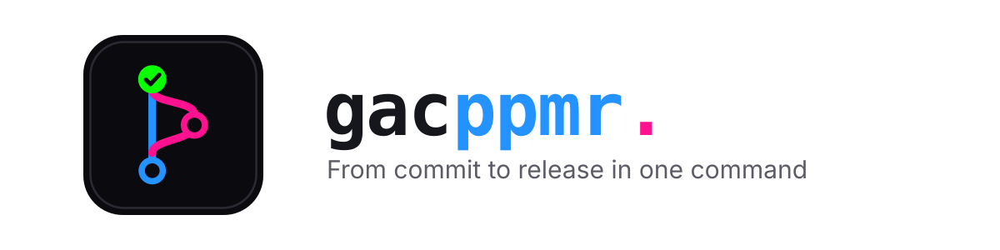

<h1 align="center">
	<picture>
		<source media="(prefers-color-scheme: dark)" srcset="../../docs/brand/banners/gac-dark.svg">
		
	</picture>
</h1>

<p align="center">
	<strong>Git add and commit in one step, with shorthands that push, open a PR, merge it once CI passes and you confirm, and publish a release.</strong>
</p>

<p align="center">
	
	<a href="../../README.md"></a>
	
	<a href="../../LICENSE"></a>
</p>

<p align="center">
	<a href="#install">Install</a> ·
	<a href="#commands">Commands</a> ·
	<a href="#merging">Merging</a> ·
	<a href="#releases">Releases</a> ·
	<a href="#where-prs-work">Where PRs work</a> ·
	<a href="#good-to-know">Good to know</a>
</p>

## Install

Add the [marketplace](../../README.md#quick-start) if you haven't, then:

```bash
/plugin install gac@webdevnerdstuff
```

> [!TIP]
> If you already have a `/gac` command, use the long form instead: `/gac:gac`, `/gac:gacp` and so on.

## Commands

Each extra letter adds a step:

| Command | Does |
| --- | --- |
| `/gac` | Stage and commit |
| `/gacp` | …then push |
| `/gacpp` | …then open a PR into the default branch |
| `/gacppm` | …then wait for CI to pass, merge the PR once you confirm, and update your local default branch |
| `/gacppmr` | …then tag the merge and publish a release |

Add files and a message after any of them, or leave them off:

```bash
/gac
```

```bash
/gacpp src/app.ts "fix header link"
```

With nothing after the command, it reads `git status` and the diff, picks the files and writes the message from what you just did. It only asks when the changes are genuinely ambiguous, like unrelated files that one message would misdescribe. Typing the shorthand as a plain message (`gacp`) works too.

<details>
<summary>Every step, in order</summary>

1. **Version** (`r`, before anything else): asks for a major, minor or patch release. See [Releases](#releases).
2. **Branch**: if you're on a main branch, it creates a descriptively named branch first. It never commits on `main`.
3. **Commit**: stages the files and commits, loading nvm first so Husky hooks run.
4. **Push** (`p`): `git push -u origin <branch>`.
5. **PR** (`pp`): opens a PR into the repo's default branch.
6. **Merge** (`m`): asks you once, waits for CI, merges with a merge commit, deletes the branch, then switches to the default branch and pulls.
7. **Release** (`r`): tags the merge and publishes the release.

It stops at the first step that fails and shows you why.

</details>

## Merging

**Merging waits for one click from you.** As soon as the PR is open, `/gacppm` shows its link, the CI state and its approvals, and asks once:

| CI is… | Buttons |
| --- | --- |
| Still running | **Merge when CI passes** / **Don't merge** |
| Passed, or no CI | **Merge** / **Don't merge** |
| Failed | None: it stops and shows what failed |

If you click **Merge when CI passes**, it waits and merges by itself once every check passes. If a check fails, it stops without merging. It won't offer to merge on a failed check, a missing required review or requested changes, and it never bypasses branch protection. **Don't merge** leaves the PR open and gives you its link.

## Releases

**Releases always ask first.** Before committing anything, `/gacppmr` asks whether this is a major, minor or patch release, showing the version each one gives (e.g. "Minor: 1.3.0"), with its suggestion first:

| Pick | When |
| --- | --- |
| Major | Anything that breaks how people use it: removed or renamed commands, options or files |
| Minor | New features |
| Patch | Fixes and small changes only |

You can also type a different version. If you already bumped the version files yourself, it offers to keep that version.

- It writes the version into `.claude-plugin/plugin.json`, `package.json` and `composer.json` (whichever exist) as part of the commit. With none of them, the release is just the tag.
- The tag follows your existing tags: `1.3.0` becomes `v1.3.0` if your tags start with `v`. It won't reuse a version that's already released.
- The release notes are the merged PR's title and summary.

## Where PRs work

| Host | PRs and merges | Releases |
| --- | --- | --- |
| GitHub | Through the [`gh`](https://cli.github.com) CLI | Yes |
| Forgejo and Gitea | Through a bundled script | Yes |
| Bitbucket Cloud | Through a bundled script | No |
| Anything else | No: commit and push only | No |

> [!NOTE]
> **Bitbucket has no releases.** `/gacppmr` on a Bitbucket repo tells you so and runs as `/gacppm`: commit, push, PR and merge, with no tag or release.

It works out the host from `origin`. The bundled scripts need macOS, `curl` and `jq`, keep their settings in `~/.config/gac/hosts.json` and keep tokens in the macOS Keychain.

### Forgejo and Gitea

The first time, it asks for your server's web URL (e.g. `http://git.example.lan:3000`) and opens a terminal for an API token with write access to repositories and issues. The token is typed there, hidden, and never passes through the chat.

### Bitbucket Cloud

The first time, it opens a terminal for your Atlassian email and an [API token](https://id.atlassian.com/manage-profile/security/api-tokens) with the Bitbucket scopes `read:repository`, `read:pullrequest` and `write:pullrequest`. A workspace or repository access token works too; leave the email blank for one of those. Self-hosted Bitbucket Server / Data Center isn't supported.

> [!TIP]
> An HTTP 401 or 403 from either script means the token is missing a permission. Make a new one with the scopes above.

## Good to know

- **Husky hooks:** if you use [nvm](https://github.com/nvm-sh/nvm), it's loaded before committing so Husky hooks (lint-staged and the like) can find Node. Without nvm, git runs as normal.
- **Jira tickets:** it never writes the ticket number into the message itself. Pair it with Husky's [`jira-prepare-commit-msg`](https://www.npmjs.com/package/jira-prepare-commit-msg) hook, which adds the ticket from the branch name (`ABC-123-fix-header` → `ABC-123`).
- **Commit messages** are short, imperative and present tense, with no period: `fix broken archive filter`. A message you give is used as-is.
- **Attribution:** whether commits and PRs credit Claude (e.g. a `Co-Authored-By` line) is up to your `CLAUDE.md` and the project's, not this skill.
- **Scope:** typing a shorthand is your go-ahead for the steps it names and nothing past them. The merge always waits for your click.

## Update and remove

See [Update and remove](../../README.md#update-and-remove) in the marketplace README.

## License

MIT © WebDevNerdStuff
